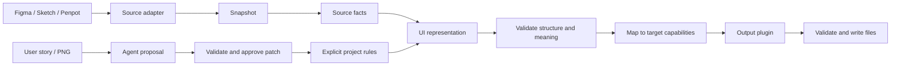

# Architecture

[Russian version](ru/architecture.md)

This document describes the planned compiler. Read uppercase requirement terms as defined in the [writing reference](reference/writing.md).

## Data flow

The core controls the stages. The [quality reference](reference/quality.md) defines the import direction and host boundaries. Integrations use public schemas and the core API. The CLI, MCP server, and coding tool adapters call the same core. Targets MAY share rules where their behavior matches. Web and native targets use their own layout and accessibility rules.

The compiler uses TypeScript and a pinned Node.js LTS version. A later MCP adapter can use JSON-RPC over standard input and output. Swift and Kotlin belong in templates, test apps, and SDK tools for their respective targets.

## Data boundaries

| Stage | Input → result | Owner and checks |
| --- | --- | --- |
| Capture | Source scope and version → `snapshot.json` and asset bytes | The capture host records the source kind, scope, versions, tree, asset digests, and source references. Its receipt records access, time, and any source version limits |
| Normalize | Snapshot → `DesignFacts` | The source adapter preserves stable IDs, child order, and links. It records observed properties and diagnostics |
| Apply UI intent | Facts, overlay, and component catalog → `UiDocument` | The core applies an explicit override first, then an exact source binding, then a documented structural default. It fails on a conflict at the same level |
| Map to a target | `UiDocument`, target version, and profile → target model and support report | The target plugin checks the required capabilities and reports allowed fallbacks |
| Emit and write | Target model → virtual file tree → output directory | The plugin returns relative paths, bytes, dependencies, and diagnostics. The shared writer checks paths, collisions, limits, and referenced resources before it commits the staged files |

An overlay is a file with explicit project rules. The plugin registry records IDs, API versions, targets, and capabilities. The first registry contains trusted built-in plugins. To activate third-party code, the operator MUST establish trust and pin its digest. Runtime limits for untrusted code require an isolation mechanism. Treat source metadata and model output as data.

## UI representation

`UiDocument` is a versioned JSON representation. It records screen trees, stable IDs, layout, semantic roles, and asset references. A component declares its properties, slots, variants, states, and typed event IDs. The host binds events to effects. Measurements have units and a fixed rounding rule. Styles can use typed tokens, modes, or allowed literal values. Diagnostics link back to a source node through `sourceRef`.

The first layout rules cover stacks, flow, fixed or content-sized dimensions, fill, gap, padding, alignment, wrapping, and explicit local overlays. Add grid, text limits, and overflow behavior when a fixture proves the mapping. One frame shows one layout. The target profile defines how to adapt it. Web can use media or container queries. Native uses window size, safe areas, text scaling, and platform interactions.

Tokens use a typed graph. The resolver MUST check alias cycles and type mismatches. Import and export use DTCG 2025.10 and its resolver where applicable. Web output uses CSS custom properties. Native output uses typed values and theme references. Catalog keys keep component names and public APIs stable. An explicit rename changes the API. [DTCG format](https://www.designtokens.org/tr/2025.10/format/) · [DTCG resolver](https://www.designtokens.org/tr/2025.10/resolver/)

For example, a Figma Auto Layout frame with `gap` and `fill` maps to a stack with a child that fills the available space. A catalog binding can map an instance to an existing component. An explicit navigation action produces a link on the web. A React component MUST preserve the role, accessible name, and event. If the action is missing, strict compilation reports the instance ID so the user can set the action.

## Reproducibility

- The build lock MUST record the snapshot, overlay, catalog, and asset digests. It also records versions of the core, plugins, and artifact manifest, plus the effective configuration. An output-affecting change changes the build key.
- Preserve ordered lists and the original Unicode sequence in text content. Order sets, file paths, and diagnostic fields with stable rules. Fix numeric rounding, file name normalization, and collision handling. Serialize deterministic metadata as canonical JSON. Write text files as UTF-8 with LF line endings. [RFC 8785](https://www.rfc-editor.org/rfc/rfc8785)
- A locked build MUST run offline. The build MUST NOT use clocks, randomness, or host metadata to produce output. Put logs, elapsed time, token counts, and costs in a separate receipt.
- The artifact manifest lists each output file by path, media type, and SHA-256. The writer MUST verify an existing output before reusing it. On a mismatch, report the changed file. An interrupted write MUST NOT publish partial output. [Contract reference](reference/contracts.md)
- Byte equality applies to declared toolchain versions and platforms. Verify support for each extra OS. Use fixed environments and tolerances for screenshots. Compare web and native output by semantics and declared behavior.

## Editor capture and export

The first Figma plugin captures a selection, observed geometry, supported links, and local assets. A pilot MUST check external library access. The capture MUST record missing components or variables. Figma REST is a separate headless option. File and image render calls can use a file version. Variable access has different permissions. Image fill links expire. Verify consistency across calls and save asset and token bytes. Figma MCP and Code Connect provide context or bindings when authorized. [Plugin export](https://developers.figma.com/docs/plugins/api/node-properties/) · [Plugin variables](https://developers.figma.com/docs/plugins/working-with-variables/) · [REST files](https://developers.figma.com/docs/rest-api/file-endpoints/) · [REST variables](https://developers.figma.com/docs/rest-api/variables-endpoints/) · [Figma MCP](https://developers.figma.com/docs/figma-mcp-server/) · [Code Connect](https://github.com/figma/code-connect)

Sketch and Penpot use versioned exports. For editable export, the core produces a typed change plan. The editor plugin applies it only to the selected document. The plan bytes and digest can match across runs. For editor-assigned IDs, compare normalized text, geometry, and bindings after capture. Check font availability before creating text. The report lists editability, font licenses, and effect loss. [Figma font loading](https://developers.figma.com/docs/plugins/api/properties/figma-loadfontasync/)

## Agent workflow

Give the agent an allowed component catalog, source references, and a proposal schema or JSON Patch contract. Validate shape, references, permitted operations, and the input digest. Strict compilation MUST use only an accepted patch. The draft allows two repair attempts. Stop at a repeated diagnostic and keep unsuccessful candidates. Measure model proposal variation separately from compiler replay.

Proposed CLI commands are `aik inspect --input <snapshot>`, `aik validate --input <document>`, `aik compile --lock <lock> --out <dir>`, and `aik verify --manifest <manifest>`. The proposed result contains status, inventory links or digests, and diagnostics. The planned MCP adapter for 0.4 exposes these operations within the current project. Thin coding tool adapters use one portable skill package. Publishing, writing to an editor, and network access use separate operation scopes.

Limit document size, depth, and asset volume. Resolve assets by declared hashes. Keep preview offline. Escape text and URIs for their output context. Define an explicit policy for active content. A UI kit MAY use registered dependencies with approval and an inventory.
