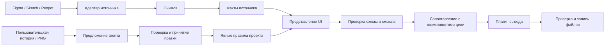

# Архитектура

[English version](../architecture.md)

Документ описывает запланированный компилятор. Значения обязательности приведены в [справочнике по документации](reference/writing.md).

## Поток данных

Ядро управляет стадиями. [Справочник по качеству](reference/quality.md) определяет направление импортов и границы хостов. Интеграции используют публичные схемы и API ядра. CLI, MCP-сервер и адаптеры агентских инструментов вызывают одно ядро. Цели могут делить правила при одинаковом поведении. Веб и мобильные SDK используют свои правила компоновки и доступности.

Компилятор использует TypeScript и закреплённую версию Node.js LTS. Будущий MCP-адаптер может использовать JSON-RPC через стандартный ввод и вывод. Swift и Kotlin нужны в шаблонах, тестовых приложениях и инструментах соответствующих SDK.

## Границы данных

| Стадия | Вход → результат | Владелец и проверки |
| --- | --- | --- |
| Захват | Область и версия источника → `snapshot.json` и байты ассетов | Хост захвата фиксирует тип, область, версии, дерево, хеши ассетов и ссылки на источник. Квитанция фиксирует доступ, время и ограничения версии источника |
| Нормализация | Снимок → `DesignFacts` | Адаптер сохраняет стабильные ID, порядок дочерних узлов и ссылки. Он фиксирует наблюдаемые свойства и диагностику |
| Применение замысла UI | Факты, overlay и каталог компонентов → `UiDocument` | Ядро сначала применяет явное правило, затем точную привязку источника, затем документированное структурное значение по умолчанию. Конфликт одного уровня блокирует сборку |
| Сопоставление с целью | `UiDocument`, версия цели и профиль → модель цели и отчёт о поддержке | Плагин цели проверяет обязательные возможности и сообщает о разрешённых заменах |
| Генерация и запись | Модель цели → виртуальное дерево файлов → папка вывода | Плагин возвращает относительные пути, байты, зависимости и диагностику. Общий модуль записи проверяет пути, коллизии, лимиты и связанные ресурсы перед публикацией подготовленных файлов |

Overlay — файл с явными правилами проекта. Реестр плагинов фиксирует ID, версии API, цели и возможности. Первый реестр содержит доверенные встроенные плагины. Перед активацией внешнего кода оператор должен установить доверие к нему и закрепить его хеш. Ограничения выполнения недоверенного кода требуют изоляции. Метаданные источника и вывод модели обрабатываются как данные.

## Представление UI

`UiDocument` — версионированное представление JSON. Оно хранит деревья экранов, стабильные ID, компоновку, семантические роли и ссылки на ассеты. Компонент объявляет свойства, слоты, варианты, состояния и типизированные ID событий. Хост связывает события с эффектами. Измерения имеют единицы и фиксированное правило округления. Стили используют типизированные токены, режимы или разрешённые литералы. Диагностика ссылается на исходный узел через `sourceRef`.

Первые правила компоновки охватывают стеки, поток, фиксированный размер или размер по содержимому, заполнение, отступы между элементами и внутри них, выравнивание, перенос и явные локальные наложения. Сетка, ограничения текста и переполнение добавляются по проверенным примерам. Один фрейм показывает одну компоновку. Профиль цели задаёт её адаптацию. Веб может использовать media или container queries. Мобильные цели учитывают размер окна, безопасные области, масштабирование текста и платформенные взаимодействия.

Токены используют типизированный граф. Модуль разрешения должен проверять циклы ссылок и несовпадение типов. Импорт и экспорт используют DTCG 2025.10 и его модуль разрешения там, где он применим. Веб использует CSS-переменные. Мобильные цели используют типизированные значения и ссылки на тему. Ключи каталога сохраняют имена компонентов и публичный API. Явное переименование меняет API. [Формат DTCG](https://www.designtokens.org/tr/2025.10/format/) · [Модуль разрешения DTCG](https://www.designtokens.org/tr/2025.10/resolver/)

Например, фрейм Figma Auto Layout с `gap` и `fill` становится стеком с дочерним узлом, который заполняет доступное место. Привязка каталога может сопоставить экземпляр с существующим компонентом. Явное действие перехода выводит ссылку в вебе. Компонент React должен сохранить роль, доступное имя и событие. Если действие отсутствует, строгая сборка сообщает ID экземпляра, чтобы пользователь мог его задать.

## Воспроизводимость

- Lock-файл сборки должен содержать хеши снимка, overlay, каталога и ассетов. Он также хранит версии ядра, плагинов и манифеста артефактов и действующую конфигурацию. Изменение, влияющее на вывод, меняет ключ сборки.
- Сохраняйте порядок списков и исходную последовательность символов Unicode в тексте. Упорядочивайте множества, пути файлов и поля диагностики по стабильным правилам. Зафиксируйте округление чисел, нормализацию имён и обработку коллизий. Сериализуйте воспроизводимые метаданные в канонический JSON. Записывайте текст в UTF-8 с окончаниями строк LF. [RFC 8785](https://www.rfc-editor.org/rfc/rfc8785)
- Сборка по lock-файлу должна работать офлайн. Часы, случайность и метаданные хоста не должны влиять на вывод. Логи, длительность, число токенов и стоимость храните в отдельной квитанции.
- Манифест артефактов перечисляет путь, медиатип и SHA-256 каждого выходного файла. Модуль записи должен проверять существующий вывод перед повторным использованием. При несовпадении он сообщает изменённый файл. Прерванная запись не должна публиковать частичный результат. [Справочник контрактов](reference/contracts.md)
- Равенство байтов действует для объявленных версий инструментов и платформ. Поддержку каждой дополнительной ОС нужно проверить. Снимки экрана сравнивают в закреплённой среде с допусками. Веб и мобильный вывод сравнивают по семантике и заявленному поведению.

## Захват и экспорт в редакторах

Первый плагин Figma захватывает выделение, наблюдаемую геометрию, поддержанные ссылки и локальные ассеты. Пилот должен проверить доступ к внешним библиотекам. Захват должен фиксировать отсутствующие компоненты и переменные. Figma REST — отдельный вариант для работы без редактора. Запросы файлов и рендера могут использовать версию файла. У переменных другие права доступа. Ссылки на изображения в заливках истекают. Проверяйте согласованность запросов и сохраняйте байты ассетов и токенов. Figma MCP и Code Connect дают контекст или привязки при наличии разрешения. [Экспорт плагина](https://developers.figma.com/docs/plugins/api/node-properties/) · [Переменные в плагине](https://developers.figma.com/docs/plugins/working-with-variables/) · [Файлы REST](https://developers.figma.com/docs/rest-api/file-endpoints/) · [Переменные REST](https://developers.figma.com/docs/rest-api/variables-endpoints/) · [Figma MCP](https://developers.figma.com/docs/figma-mcp-server/) · [Code Connect](https://github.com/figma/code-connect)

Sketch и Penpot используют версионированные экспорты. Для редактируемого вывода ядро формирует типизированный план изменений. Плагин применяет его только к выбранному документу. Байты и хеш плана могут совпасть при повторе. Для ID, назначенных редактором, сравнивайте нормализованные текст, геометрию и привязки после захвата. Перед созданием текста проверяйте доступность шрифта. Отчёт перечисляет редактируемые свойства, лицензии шрифтов и потерянные эффекты. [Загрузка шрифтов в Figma](https://developers.figma.com/docs/plugins/api/properties/figma-loadfontasync/)

## Работа агента

Передайте агенту разрешённый каталог компонентов, ссылки на источник и схему предложения или контракт JSON Patch. Проверьте структуру, ссылки, разрешённые операции и хеш входа. Строгая компиляция должна использовать только принятую правку. Черновик допускает две попытки исправления. Остановитесь при повторной диагностике и сохраните неудавшиеся варианты. Измеряйте вариативность предложений модели отдельно от повтора компиляции.

Предлагаемые команды CLI — `aik inspect --input <snapshot>`, `aik validate --input <document>`, `aik compile --lock <lock> --out <dir>` и `aik verify --manifest <manifest>`. Предлагаемый результат содержит статус, ссылки или хеши инвентаря и диагностику. MCP-адаптер 0.4 предоставит операции в границах текущего проекта. Простые адаптеры агентских инструментов используют один переносимый пакет навыков. Публикация, запись в редактор и доступ к сети имеют отдельные области операций.

Ограничивайте размер документов, глубину и объём ассетов. Разрешайте ассеты по объявленным хешам. Запускайте предпросмотр офлайн. Экранируйте текст и URI для контекста вывода. Задайте явную политику активного содержимого. UI-кит может использовать зарегистрированные зависимости с разрешением и инвентарём.
